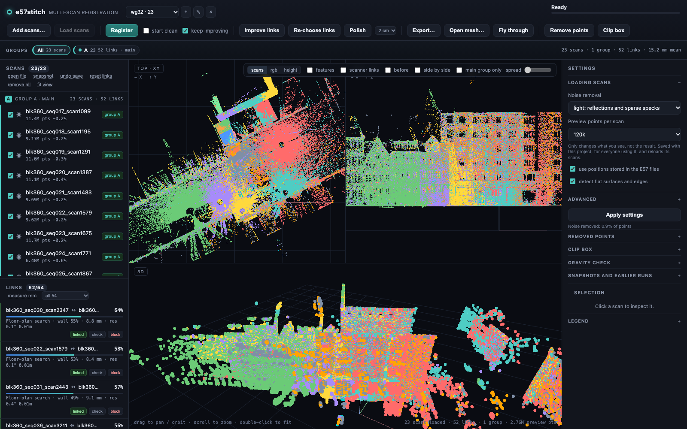
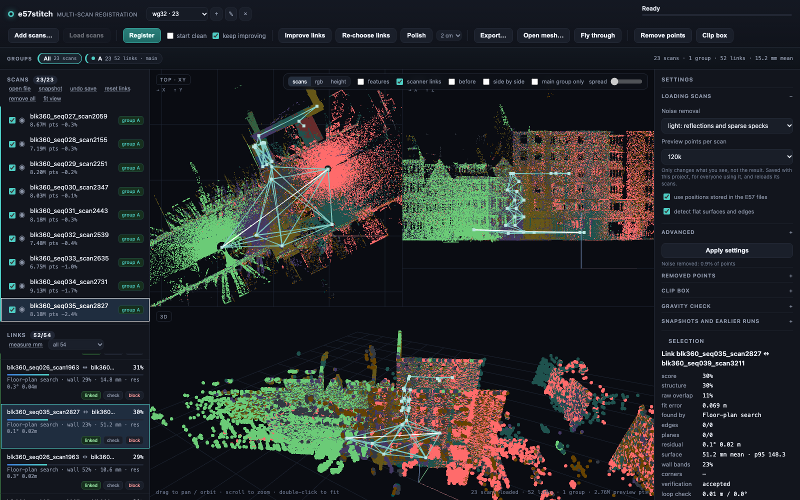
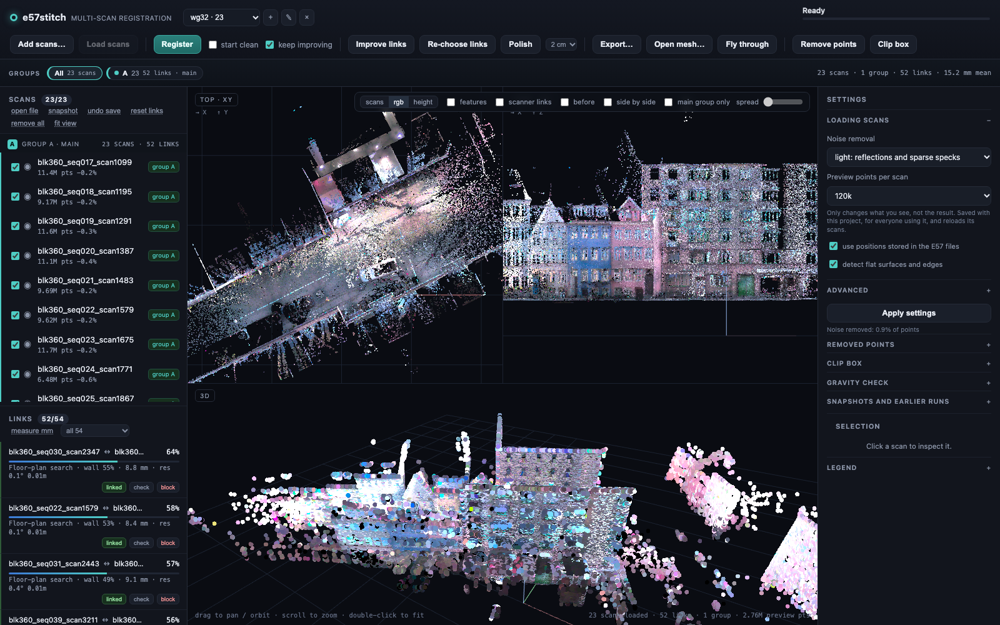
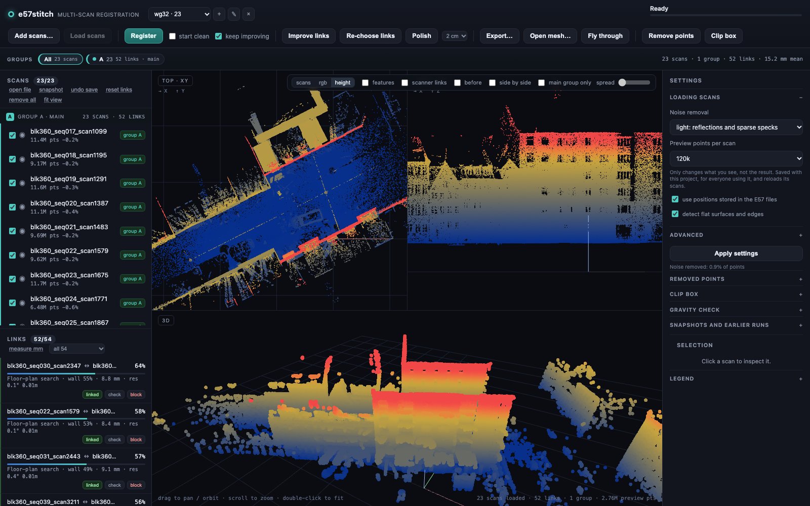
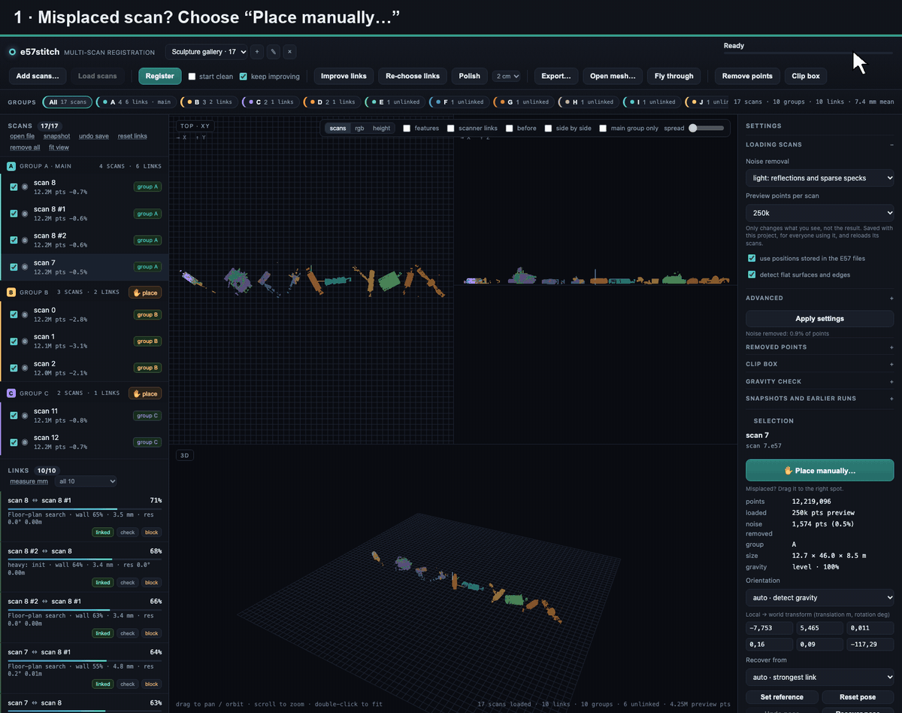
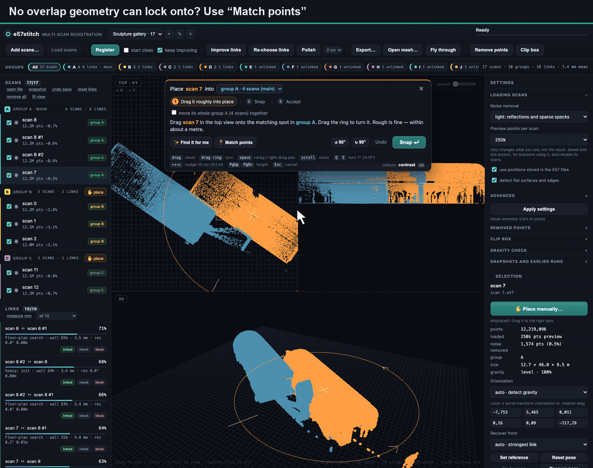
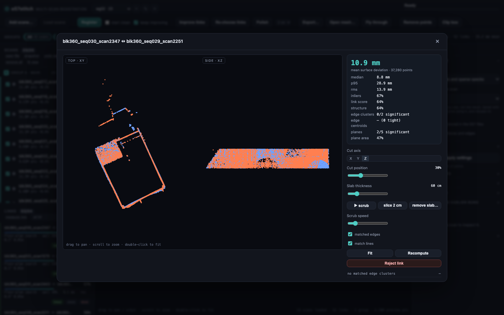

# e57stitch

Register multiple E57 terrestrial laser scans into one aligned point cloud, in
a local web app with top, side and 3D views of the scans before and after
alignment.



> **Vibe-coded.** e57stitch was written entirely by an AI coding assistant
> (Claude Code), directed and tested by a human against real scans. The code
> has not been reviewed line by line. It works well on the data it was tested
> on, but expect rough edges, and check the result before you rely on it for
> survey work.

> **Security:** e57stitch is a single-user tool with no login. Its file
> browser and export can read and write any path the server process can reach.
> Keep it on `127.0.0.1` (the default) or a network you trust; never expose it
> to the internet.

## Why

Terrestrial laser scans (Faro, Leica, Z+F, ReCap, …) almost always come as
separate stations. Storing them in one E57 file does not mean they line up:
poses are often missing, identity, or only roughly correct. e57stitch finds the
scans that actually share geometry, matches their local features, solves a
consistent set of global poses, and exports a merged cloud.

It deliberately **does not force every scan into one coordinate system**.
Scans from different rooms / floors / buildings often share nothing, so they are
reported as separate *overlap groups* and kept out of the main solution.

## What it does

* **Load** one or more E57 files (one scan or many per file), with SHA-256
  de-duplication, a noise filter for reflections and glass, and an automatic
  gravity estimate per scan.
* **Look before you align:** top, side and 3D views of the raw scans, coloured
  by scan, RGB or height.
* **Register** without stored poses: every pair is matched by floor plan
  (a top-down search over yaw and position, then ICP), checked against wall
  evidence and the rest of the building, and the links that agree are chosen.
  Separate pieces are joined, and the result is polished with GICP.
* **Keep improving** in the background with slower matchers (FPFH + RANSAC /
  Fast Global Registration, Manhattan-wall hypotheses) on scans that are still
  unlinked or unsure.
* **Check every link:** a surface deviation in millimetres per link, a
  cross-section viewer with a movable slab, and a *scanner links* view of how
  the scans are connected.
* **Fix it by hand:** accept, reject or permanently block a link, drag a scan
  into place, or match points between two panoramas
  ([see below](#placing-a-scan-by-hand)). Hand placements are stored
  separately and always win.
* **Clean up:** remove-point boxes and a clip box (for example to drop the
  ceiling for a floor plan) that apply to preview, export and mesh.
* **Export** merged or separate scans to E57, PLY, PTS or XYZ at full
  resolution with RGB and intensity, or a triangle mesh (PLY/OBJ/GLB), and
  fly through the result in first person.
* **Projects** keep scans, links and settings apart, autosave after every
  change, and take snapshots before risky operations.

## Built with

| tool | what e57stitch uses it for |
| --- | --- |
| [Open3D](https://www.open3d.org) | point clouds, normals, FPFH features, RANSAC and Fast Global Registration, point-to-plane / coloured / generalised ICP, DBSCAN, plane fitting, Poisson and ball-pivoting meshing |
| [small_gicp](https://github.com/koide3/small_gicp) | fast GICP / VGICP for the final polish (optional; falls back to Open3D) |
| [pye57](https://github.com/davidcaron/pye57) with [libE57Format](https://github.com/asmaloney/libE57Format) | reading and writing E57 |
| [NumPy](https://numpy.org), [SciPy](https://scipy.org) | geometry, KD-trees, the pose-graph least-squares solve |
| [FastAPI](https://fastapi.tiangolo.com), [Uvicorn](https://www.uvicorn.org) | the local web server |
| [three.js](https://threejs.org) | the viewer (vendored, no build step) |
| [Pillow](https://python-pillow.org) | panorama images |

The floor-plan matcher, link scoring and selection, wall evidence, pose graph
and polish logic are e57stitch's own; the libraries supply the building
blocks. All of them are under permissive licences (MIT, BSD, Apache-2.0,
BSL-1.0), so they can be redistributed with e57stitch, including in the Docker
image. See [THIRD_PARTY_NOTICES.md](THIRD_PARTY_NOTICES.md).

## Quick start

```bash
git clone https://github.com/kapsel/e57stitch.git && cd e57stitch
./run.sh              # creates .venv, installs deps, opens the UI
```

or manually:

```bash
uv venv --python 3.12 .venv
uv pip install -e .
python -m e57stitch serve
```

On macOS Open3D needs libusb: `brew install libusb` (once).

The app runs locally at <http://127.0.0.1:8765>. Nothing is uploaded anywhere.

For an unattended server run (survives the terminal; keeps the Mac awake on
macOS via `caffeinate`):

```bash
nohup ./run.sh --no-open --port 8765 > ~/e57stitch.log 2>&1 &
curl -s http://127.0.0.1:8765/api/health
```

### Docker

Released images are published to the GitHub Container Registry:

```bash
mkdir -p scans data        # put your .e57 files in ./scans
docker run -d --name e57stitch -p 127.0.0.1:9090:9090 --shm-size 2g \
  -e E57STITCH_CACHE=/data/cache -e E57STITCH_MANUAL_DB=/data/manual/manual_links.sqlite \
  -v "$PWD/scans:/scans" -v "$PWD/data:/data" \
  ghcr.io/kapsel/e57stitch:0.1.0
```

or build from source with `docker compose up -d --build`.

Open <http://localhost:9090> and add scans from `/scans`. Caches, projects and
saved links live in `./data`. The compose file publishes the port on localhost
only; see the security note above before changing that.

Settings that can be set through the environment:

| variable | default |
| --- | --- |
| `E57STITCH_CACHE` | `~/.cache/e57stitch` (scan bundles, link cache, projects) |
| `E57STITCH_DB` | `$E57STITCH_CACHE/e57stitch.sqlite` |
| `E57STITCH_MANUAL_DB` | `~/Library/Application Support/e57stitch/` on macOS, `~/.local/share/e57stitch/` elsewhere, file `manual_links.sqlite` (hand-made and blocked links) |

## Ingest & dedup

* Files are hashed with **SHA-256** on ingest. The hash is stored in SQLite and
  a JSON registry; the same file (even copied to another path) is not added to
  the same project twice, and by default not to another project either. Use
  *allow duplicates* in the file browser to override.

## Cache (SQLite)

Heavy results are content-addressed in `~/.cache/e57stitch/e57stitch.sqlite`:

* file SHA-256s and scan metadata,
* scan bundles (registration cloud, preview base, features, noise stats),
* pairwise links, keyed by the two scan checksums **and the settings signature**
  (voxel, cleanup, pose handling, feature/engine version),
* per-scan noise counts.

Switching a setting back to a previous value and pressing *Register*
reuses the cached links (typically a couple of seconds instead of tens of
minutes). Changing `voxel`/`cleanup`
still builds a new scan bundle once, but it is cached thereafter; preview
counts reuse the 500 k preview base and are instant.

## Projects

Scans are grouped into **projects**. A project is one registration job: its
scans are matched only against each other, never against scans from another
project. This matters when you have scans from unrelated rooms or sites — there
is no point in testing 200 cross-project pairs that can never overlap.

* The project selector in the header switches projects; **+**, **✎**, **×**
  create, rename and delete them.
* Every project keeps its own scans, links, groups, transforms, reference and
  parameters.
* Everything is autosaved to `~/.cache/e57stitch/projects/<id>/project.json`
  after every change and after every job, so you can close the browser (or
  restart the server) and continue later.
* Deleting a project removes its alignment metadata only; the E57 files are
  untouched.
* The **undo save** link in the Scans header restores the previous project
  autosave (one save behind), so a registration reset cannot silently destroy a
  long alignment.

## Workflow

1. Create/select a **project**, then **Add scans…** → pick one or more `.e57`
   files, or add a whole folder.  Files are read directly from disk (no
   upload).
2. Scans are loaded at a 5 cm registration resolution and a preview cloud is
   built. The three viewports show the scans **in their raw local frames** from
   above and from the side, so you can see what is where before touching
   anything. The *side by side* toggle arranges the scans side by side for
   inspection; switch it off to see their true relative positions.
   The *scanner links* toggle draws a line between the scanner positions of
   every linked pair, to show how the scans are connected. Click a line to
   select that link: its row in the list of links and its two scans in the
   list of scans are highlighted.

   

   **block** on a row of the list of links bans that scan pair for good: no
   matcher, re-choose, reset or hand placement links the two scans again, in
   any project that holds both. Blocking moves no scan; press **re-choose
   links** when you want the layout updated without it. Undo (or **unblock**
   under the *blocked* filter) puts the row back exactly, as long as neither
   scan has moved since.
3. **Register** places everything: it matches every pair by floor plan (a
   top-down search over yaw and position, followed by ICP), chooses the links
   that agree across the whole building, joins separated pieces with a search
   limited to 8 m around the scanners, and polishes. Results are stored, so a
   second run is much quicker: a 23-scan building takes about 15 minutes from
   scratch on a 20-thread machine and about 4.5 minutes with stored results.
4. **start clean** next to Register deletes the stored results for these scans
   first and searches everything again. That includes slow results from earlier
   *keep improving* runs, also in other projects that use the same scans. It
   asks first and unticks itself when the run starts.
5. **keep improving** continues after the first result with the slower matchers
   on unlinked scans, scans held by one link and unsure pairs. **Improve links**
   runs the same thing on demand. Stop any time: progress is kept.
6. Review the link list: each row shows the score, how the link was found, and
   its fit. Accepting a link pins it as a manual link; rejecting one keeps that
   position out of later runs. Links are then chosen again automatically.
   **Re-choose links** does this by hand from the stored results.
   A scan or group that stays unlinked gets a ✋ button: drag it into place by
   hand, or match a few points between panoramas. Hand placements are kept
   in a separate store and always win over the automatic matchers.
7. **Polish** fine-tunes every scan against all its linked neighbours. Links
   stay as they are, and the result is kept only if the measured fit improves.
8. **Export…** writes E57 / PLY / PTS / XYZ, either merged into one scan or as
   separate scans, from the main group or all groups. The default is **full
   resolution and every valid point**, with the load-time noise filter applied.
   Exports use the real registration coordinates; the side-by-side parking of
   disconnected groups is display-only and is never baked into survey files.
   RGB **and intensity** are preserved: E57 stores both, PTS stores both, PLY
   now writes a float `intensity` property, and XYZ appends intensity after RGB.
   The same dialog can export a **triangle mesh** (Poisson or ball pivoting,
   `.ply` / `.obj` / `.glb`); the mesh PLY keeps per-vertex RGB + intensity.
   Two optional density modes:
   * *adaptive* keeps all points in sparse areas and only caps voxels that
     contain more than N points (dense down over-sampled areas without losing
     detail elsewhere),
   * *uniform* keeps one representative point per voxel.

The *open file* link in the Scans header loads a saved `session.json` back into
the active project (useful for resuming a long run after a restart).

The viewport colours scans by scan, by their RGB, or by height:

| RGB | height |
| --- | --- |
|  |  |

The *before* toggle replays the transforms captured when you pressed Register,
so you can flip between the raw and aligned state.

### Groups strip

Connected groups live in a full-width strip above the viewport: **All**, then
one colour-coded chip per group with its scan count, link count and `main`
marker, plus an **Unlinked** chip. Click a chip to focus that group; double-click
to make its scan the reference frame. The scan list is also grouped under the
same colour-coded headers, so grouped scans are visibly distinct from unlinked
ones.

### Settings

Settings are grouped into *Loading scans* (noise removal, preview size, stored
positions, feature detection) and *Advanced* (minimum link score, parallel
workers). Press **Apply settings** to save them; loading settings need
**Load scans** afterwards. Matching resolution is fixed at 5 cm.

### Gravity / non-terrestrial scans

Scans are not always levelled. On load, each scan gets an **auto gravity
estimate** from its dominant floor/ceiling-like parallel planes. The scan's
orientation is shown in the *Selection* panel and low-confidence scans appear
under *Gravity check* in Settings:

* **auto** — use the detected axis, or full 6-DOF if it is uncertain,
* **level** — force local +Z up (scanner stood on a flat surface),
* **free** — disable gravity constraints and use full 6-DOF matching.

Changing this rebuilds only that scan's bundle. Upside-down scans are handled by
trying both gravity signs during matching; sideways scans get their detected
axis and are matched with the same constrained search. Nothing is global or
destructive, so you only touch a scan when its badge looks wrong.

### Scans that do not connect

The group strip above the viewport lists overlap groups:

* **Group A** is the main solution (most connected scans).
* Other groups are **unlinked** — no reliable overlap with the main group. They
  are parked to the right of the main group in the viewport (display only) so
  they do not stack on top of it. Click a group card to make it the active
  reference group; exports with scope *main connected group* then use it.

Typical reasons: the scans are from another room/facade, or a shared corridor
was not scanned. *Improve links* tries the slower matchers on them; if that
does not help, place them by hand. *Minimum link score* under *Advanced* makes
linking stricter or looser (the CLI equivalent is `--accept`).

### Placing a scan by hand

When a scan is unlinked or sits in the wrong spot, select it and press
**Place manually…** (or **✋ place** on a group card). Only the scan you are
placing and the group you are placing it into stay visible, in two contrasting
colours, so you can see where the walls line up.

**Drag it into place.** In the top view, drag the scan to roughly where it
belongs and drag the orange ring to turn it. Being within half a metre and a
few degrees is enough. **Snap** then fits it to the walls with ICP. It reports
the surface error, the shared wall area and the overlap, and says plainly when
the fit is poor. **Accept** saves the placement as a fixed link that later
registration runs keep.



**Match points.** Some scans can't be placed from geometry alone, for example
a long, featureless corridor or a room that only shares a doorway. For these,
**📍 Match points** opens the two scans as panoramas side by side. Click a
sharp, recognisable spot in the top panorama, such as a door corner, a ceiling
rosette or a statue, then the same spot in the bottom one. Each click snaps to
the nearest measured surface. After two pairs the scan has a position, and a
dashed circle shows where the next partner should be. Every pair gets a
residual in centimetres, so a mis-click shows up straight away. **Use these
points** places the scan from the markers and snaps it to the walls. The
markers are saved with the placement.



People who were in the room while it was scanned are blurred in these
recordings.

## How it works

| stage | what happens |
| --- | --- |
| load | one pass over each scan: full-res points + colours/intensity, 5 cm registration cloud, 120 k preview, cached in `~/.cache/e57stitch` |
| features | normals, FPFH descriptors, dominant RANSAC planes, edge/high-curvature points clustered with DBSCAN |
| pair proposal | all combinations for small sets, centroid-distance ranking for large sets |
| gravity | per-scan up axis from floor/ceiling-like parallel planes; used for structure scoring and constrained hypotheses; user override per scan |
| coarse alignment | floor-plan search (top-down occupancy over yaw and position, then ICP); the slower matchers add FPFH + Fast Global Registration, RANSAC, Manhattan-wall hypotheses (yaw/90° grid) and a spectral correspondence selector; gravity snap tries both up signs |
| scoring | symmetric nearest-neighbour overlap of **vertical** points (`|n·up| < 0.6`), split into height bands; plus raw overlap and RMSE |
| wall verification | wall-band score + matched significant planes/edges; flat-only links are rejected and flagged |
| refinement | Gauss-Seidel multi-view point-to-plane ICP + GICP, vertical-only ICP, colour-aware ICP on promising pairs; reference fixed |
| global solve | maximum spanning tree over accepted links → robust least-squares pose graph (Cauchy loss, outlier rejection); two-hop cycle consistency is reported per link |
| merged-model growth | per-group synthesized cloud → matching of remaining scans, cross-group scans and other groups → attach → refine → repeat |


Scoring vertical structure matters because two scans of a plaza can share a 70 %
"flat" overlap while their walls are metres apart. Ground planes dominate raw
ICP fitness; walls, windows and columns do not.

Edge/plane detection is also shown in the viewport (*features* toggle) and used
to report how many distinct edge clusters two aligned scans share. Every pair
keeps its top three non-duplicate hypotheses; the panel shows them next to the
chosen pose, and the cycle row shows how far the link disagrees with alternate
two-hop paths (a warning that a single link is geometrically inconsistent even
if it looks good on its own).

## CLI

```bash
# inspect scan headers
python -m e57stitch info scans/*.e57

# headless registration + merge (main connected group)
python -m e57stitch register scans -o merged.e57 \
    --voxel 0.05 --accept 0.15 --refine 2 --export-voxel 0.02

# merged-model growth (recommended when time allows)
python -m e57stitch register scans --deep --passes 6 -o all.e57
# export every point (default) or cap dense areas
python -m e57stitch register scans -o all.e57                       # full
python -m e57stitch register scans -o all.e57 --density-cap 2       # adaptive
python -m e57stitch register scans -o all.e57 --export-voxel 0.02   # uniform

# resume a saved session without repeating the pairwise pass
python -m e57stitch register scans --resume session.json --deep --passes 4 -o all.e57

# everything, one data3D per scan
python -m e57stitch register scans -o all.e57 --scope all --mode separate

# PLY / PTS / XYZ
python -m e57stitch register scans -o merged.ply --format ply
```

A sidecar `<output>.json` manifest (counts, scans, params, accuracy, cleanup
regions) is written next to every export. Deep runs also write
`~/.cache/e57stitch/runs/<timestamp>/run.log` and `session.json` after every
pass — the log tells you which scans were attached or merged and why.

Useful flags: `--attempts N` (global matching attempts per hard pair),
`--workers N`, `--deep`, `--passes N`, `--resume FILE`,
`--ignore-pose` (do not use poses stored in E57),
`--no-features` (skip plane/edge detection), `--no-colors`.

## Mesh export, fly-through and cleanup

**Mesh** (Export → *Mesh · PLY/OBJ/GLB*) triangulates the registered cloud with
Open3D Poisson (depth 6–12) or ball pivoting. The input is decimated to a safe
number of points, low-density Poisson vertices are removed, and RGB/intensity
are transferred back by nearest neighbour. A mesh PLY carries RGB + a float
intensity scalar; OBJ/GLB carry RGB (intensity can be baked to a colour ramp).
After the mesh is written it loads automatically into the viewport. Meshing is
run in a detached child process because Open3D's Poisson can abort on
pathological geometry; it retries with a smaller cloud/lower depth. Treat the
mesh as a visual/occlusion surface: at the current ~5 cm cross-scan alignment
error, a 2 cm mesh will show double walls and soft seams, so a 5 cm mesh is the
honest default. E57 cannot store triangles, so the mesh is a PLY/OBJ/GLB
sidecar.

**Fly** (toolbar) enters a first-person camera: `WASD` move, `Q`/`E` down/up,
`Shift` faster, mouse look, `P` toggles points/mesh, `Esc` exits. Works for
points and for the triangulated mesh.

**Removed-point regions** are a non-destructive layer: press **Remove points**, then drag a
box in the top or side view (it applies to the selected scans, or all scans if
nothing is selected). Enabled regions are listed in *Settings → Removed points*
and can be toggled or deleted. They hide points in the preview via the point
shader and are applied to full-resolution E57/PLY/PTS/XYZ and mesh exports; the
registration cloud and link cache are untouched.

**Clip box (drop the ceiling)**: press **Clip** in the toolbar. It detects the
ceiling height of the visible scans (highest strong horizontal peak in the
height histogram, per overlap group; the lowest one wins) and keeps only points
below it, so the top view shows the floor plan. *Settings → Clip box* has Top /
Bottom sliders, optional X/Y limits (*fit X/Y*, empty = unbounded), *detect
ceiling* and *remove*. The box is in registration coordinates, stored as a
`keep` cleanup region with `clip: true` (one per project), hides points in the
preview and is applied to point and mesh exports. Registration still uses the
ceiling, which helps gravity estimation. Groups that are not linked to each
other have different frames, so their ceilings sit at different heights; focus
one group (hide the others) before *detect ceiling* to cut that group exactly.

**Snapshots**: *snapshot* in the Scans header writes an immutable timestamped
copy of the project under `projects/<id>/snapshots/`. The server also snapshots
before a start-clean run and automatically every five minutes during long runs, so
an accidental reset or a bad overnight result can always be rolled back.

**Health**: `GET /api/health` returns project, scan/link/group counts and the
busy job id. `run.sh` wraps the server in `caffeinate -imsu` on macOS so an
overnight run does not sleep.

### Flat floors and underconstrained links

A large flat floor leaves X/Y/yaw unconstrained. The matcher now:

* splits vertical structure into **height bands** and uses the band score as a
  tie-breaker, so a floor-only fit cannot beat a wall-correct one;
* runs a **vertical-only ICP** stage in addition to the all-point ICP;
* seeds a structure-only FGR and Manhattan hypotheses when the wall score is
  weak;
* computes `planes_tight` / `edges_tight` and a feature score after alignment;
* marks floor-dominated pairs as **flat-only / underconstrained**, gives them a
  much lower pose-graph weight, and refuses to auto-accept them. They remain in
  the pair list so you can accept one deliberately if you know the scans do
  overlap.

The link panel shows `wall bands` (e.g. `42%`) and `flat-only / underconstrained`
next to the surface mm. A large `surface` error with `planes 0/…` usually means
the floor is aligned and the walls are not.

## Accuracy & validating links

Every accepted link reports a **surface deviation in millimetres** (robust
point-to-plane distance, both directions) plus coverage. Large planes are
matched by plane equation and area (not by centroid, which differs when two
scans see different parts of a wall), so the panel also shows matched large
surfaces and their area percentage.

Select a pair → **cut-through**: two orthographic views of just those scans with
a movable X/Y/Z slab, matched significant edge clusters and planes highlighted,
match vectors coloured by deviation, and a **CT-style scrub** (play/pause, speed,
2 cm slice preset, arrow keys).


 Links you reject stay in the list in place (no
re-sorting), with a filter (all/linked/rejected by you) and an **Undo** action
after toggling. Candidates the selection rejected on its own are not listed;
**Improve links** still retries those pairs.

## Noise cleanup

*Noise removal* under *Loading scans* (off / light / strong) runs during loading, before any
matching:

* *light* removes points with fewer than ~4 neighbours in a 10–15 cm radius,
* *strong* also removes small DBSCAN clusters (fragmented specks).

Typical data sets lose 0.5–3 % (light) or 5–15 % (strong) of points. The removed
count is shown per scan and in the SQLite cache. The same filter is transferred
to the full-resolution export.

## Notes & limits

* Registration is done at 5 cm by default; export can be full resolution or
  downsampled (0 = every point).
* E57 writing streams chunks, so merging 17 × 9 M points does not blow up RAM.
* Export density modes are applied per scan; overlapping scans still contribute
  both of their full point sets in *full* mode (that is the "no data thrown
  away" choice). Use adaptive mode to thin overlaps without a global loss of
  resolution.
* The noise filter applied at export is conservative: a full-resolution point
  survives if there is a kept registration-voxel point nearby. This removes
  isolated reflection/glass specks while preserving detail on real surfaces.
* Repetitive architecture (identical facades, long featureless corridors) is
  inherently ambiguous. Use the pair list + *before* toggle to check, reject a
  bad link, and set a scan's transform numerically in the Selection panel.
* Coordinates are kept as they are; no georeferencing is attempted.
* The app is a local single-user tool; the server binds to 127.0.0.1 and has
  no authentication (see the security note at the top).

## Project layout

```
e57stitch/
  e57io.py       E57 read/write (pye57 + libE57Format), streaming exporters
  features.py    normals, FPFH, planes, edge clusters, feature matching
  register.py    pair registration, structure scoring, pose graph, multi-view ICP
  projects.py    isolated projects, on-disk autosave, active-project proxy
  session.py     scans, previews, pairs, groups, background jobs, export
  cleanup.py     non-destructive box/sphere cleanup regions (export + preview)
  mesh.py        Poisson / ball-pivoting meshing, PLY/OBJ/GLB writers
  server.py      FastAPI endpoints + binary preview/feature/mesh payloads
  cli.py         serve / info / register
  web/           Three.js UI (three viewports, no build step)
tests/
  test_*.py      unit tests (python -m unittest discover tests)
  bench/         benchmark runner and scorer against your own truth files
docs/images/     screenshots for this README
Dockerfile, compose.yaml, constraints.txt   Docker image (pinned dependency versions)
.github/workflows/docker.yml                build, test and publish the image
THIRD_PARTY_NOTICES.md                      licences of the libraries used
```

## Tests and benchmarks

```bash
python -m unittest discover tests
```

`tests/bench/` scores a registration against a truth file of known poses
(`score.py`), runs a timed registration on a server and appends the result to
a history (`run.py`), and restores a project from a saved file (`restore.py`).
Truth files and the history are not part of the repository, since they belong
to your own scan data. A truth file is JSON keyed by scan label:

```json
{
  "note": "where the poses came from",
  "groups": [["scan_a", "scan_b", "scan_c"], ["scan_x"]],
  "poses": {"scan_a": [[1,0,0,0],[0,1,0,0],[0,0,1,0],[0,0,0,1]], "...": "4x4"},
  "relative": {"scan_a|scan_b": "4x4: inv(pose_b) @ pose_a", "...": "..."}
}
```

`groups` are scans that truly overlap; a link between two different
multi-scan groups counts as a hard error. The docstring of `run.py` shows how
to name benchmarks.

## Releasing

The version lives in `e57stitch/__init__.py`; `constraints.txt` pins the
dependency versions the Docker image is built and tested with. To release:

1. Bump `__version__`, commit, and tag: `git tag v0.1.0 && git push --tags`.
2. The `docker` workflow builds the image, runs the unit tests and a health
   check in it, and pushes `ghcr.io/kapsel/e57stitch:0.1.0`, `:0.1` and
   `:latest`.
3. On the first release, make the package public under the repository's
   *Packages* settings (new GHCR packages are private).

Pushes to `main` and pull requests run the same build and tests without
publishing.

## Licence

MIT, see [LICENSE](LICENSE). The screenshots show the author's own scans.

e57stitch includes three.js (MIT) and depends on Open3D, small_gicp, pye57 /
libE57Format and others under permissive licences; see
[THIRD_PARTY_NOTICES.md](THIRD_PARTY_NOTICES.md).
